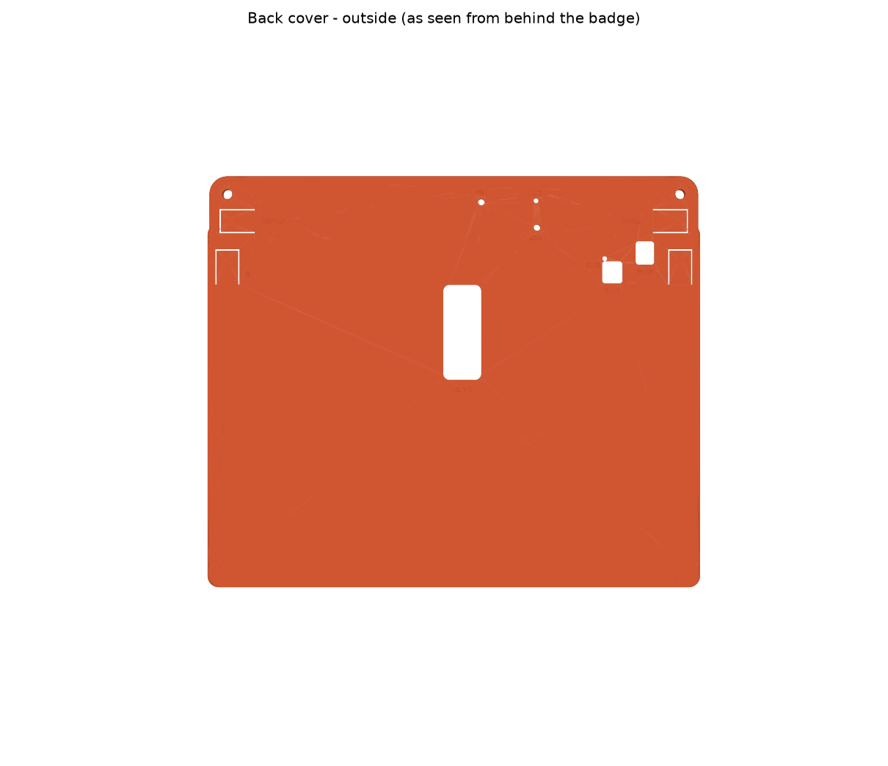
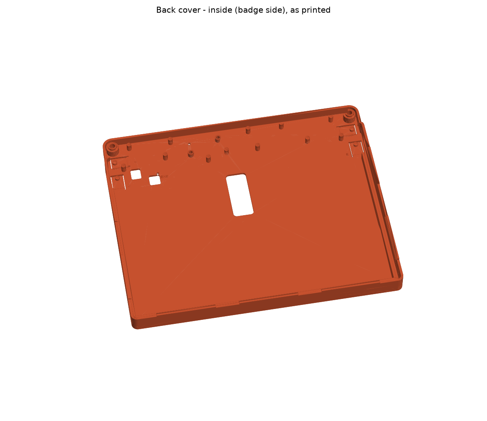

# Billboard Badge back cover

A printable snap-on back shell for the Supercon 2026 Billboard Badge. It clips over the printed front bezel (`../billboard_mockup-Frame.step`) and covers the back of the e-paper panel and the PCB. It has flex buttons for MENU−/MENU+/A/B, openings for USB-C, the power switch and the battery connector, and room for a LiPo pouch.

photo: TBD




| File | Use |
|---|---|
| `billboard_back_cover.3mf` / `.stl` | Print this |
| `billboard_back_cover.step` | Open in Fusion, FreeCAD or Onshape to modify |
| `billboard_back_cover.py` | Parametric source ([build123d](https://github.com/gumyr/build123d)) |
| `keepouts.json` | PCB back-side part outlines, used to place the support posts |
| `render_previews.py` | Regenerates the preview and section PNGs |
| `preview_*.png`, `section_*.png` | Renders and fit cross-sections |

## Tested on

- **Printer:** Prusa XL
- **Material:** PLA, printed in two colours (orange and transparent purple)
- **Layer height:** 0.20 mm
- **Supports:** none
- **Fit:** confirmed on a real badge with the printed front bezel at Supercon 2026

## Printing

- **Bed:** needs at least **235 × 197 mm**. The part is 232 × 194 × 17 mm. An Ender-3 sized bed (220 mm) is too small.
- **Orientation:** back face on the bed, exactly as exported. No supports needed; the lips overhang only 1 mm.
- **Material:** PLA works (see Tested on below).

## Assembly

1. Lay the cover on the table, inside facing up.
2. Hold the bezel, display and PCB together. Lower them in face-up, with the PCB's lanyard holes over the two bosses.
3. Press down along the left, right and bottom edges until the lips click over the bezel's front face.
4. To remove, flex a side wall outward at a lip segment and lift that edge.

## Where the dimensions come from

| Feature | Source | Value |
|---|---|---|
| Bezel outline | Frame STEP | 227.6 × 167.12 × 5.0 mm, R3 corners |
| Display pocket | Frame STEP | 3 mm deep. Back borders: 7.8 mm bottom, 8.2 mm right, 2.4 mm left |
| PCB outline | KiCad Edge.Cuts | 225.6 × 50 mm strip, 1.6 mm thick, sits behind the top of the display and sticks out 22.2 mm above the bezel |
| Lanyard holes | KiCad | Ø8 at (±106.8, 99.74) |
| Stack-up | FreeCAD mockup | Bezel back face = PCB front face (Z = 0) |
| Parts on PCB back | KiCad footprints + vendor 3D models | Tact switches 5.0 mm, power slide 4.6 mm, battery connector 5.6 mm, display flex loops reach 6.05 mm behind the bezel |

## Features

- **Snap lips**, 1 mm, in 7 short segments on the left, right and bottom walls. They hook over the bezel's front face. The top edge has no wall because the PCB continues there.
- **Seat ribs** that press the bezel's back border forward against the lips. Nothing presses on the display glass.
- **Lanyard bosses** that pass up through the PCB's 8 mm holes. They locate the PCB and keep Ø4.8 lanyard holes open through the cover.
- **12 PCB support posts**, placed by script to stay at least 0.8 mm clear of every part on the PCB back.
- **4 flex buttons** (10 × 16 mm flaps, 1.2 mm thick, with a nub) over the tact switches: **MENU−, MENU+, A, B**. The A and B flaps run vertically so they miss the power switch.
- **Openings:**
  - USB-C plug window (18 × 45 mm). The port faces down behind the display, so the plug goes in through the window.
  - Power slide switch.
  - Battery connector (PH2.0, vertical).
  - Paper-clip holes with guide tubes for **BOOT** (SW2 → IO0) and **RST** (SW1 → EN).
  - Light holes for the charge and status LEDs.
- **Engraved labels**, readable from the back. Seen from the back the menu buttons are mirrored: **MENU− and A are on the right**, MENU+ and B on the left.
- **8.5 mm internal depth** behind the display, which fits a LiPo pouch up to about 7 mm thick (for example a 603450). Stick it on with foam tape.

## Parameters

At the top of `billboard_back_cover.py` (all mm):

| Name | Default | Meaning |
|---|---|---|
| `WALL` | 2 | Side wall thickness |
| `FLOOR` | 2 | Back plate thickness |
| `CAVITY` | 8.5 | Depth from the bezel back to the inside of the back plate |
| `CLEAR_BEZEL` | 0.25 | Gap between bezel edge and wall, per side |
| `CLEAR_PCB` | 0.4 | Gap between PCB edge and wall, per side |
| `LIP` | 1.0 | How far the snap lips reach over the bezel's front face |
| `LIP_GAP` | 0.15 | Vertical play between bezel front face and lip underside |
| `BUTTON_GAP` | 0.3 | Air gap between button nub and tact-switch plunger |

## Adjusting and rebuilding

- **Bezel prints large:** measure it with calipers. The model expects **227.6 × 167.1 mm, 5.0 mm thick**. If yours is bigger, raise `CLEAR_BEZEL`. If it is thicker or thinner, change `BEZEL_T`.
- **Thicker battery:** raise `CAVITY`. With no battery you can drop it to 7.5 for a thinner case.
- **USB cable:** a slim plug, or a 90° plug angled toward the back, is easiest.

To rebuild after changing a parameter:

```sh
pip install build123d
cd hardware/back_cover
python3 billboard_back_cover.py --check   # rewrites the .stl/.3mf/.step here and runs the fit check
python3 render_previews.py                 # optional: regenerate the PNGs (needs matplotlib)
```

`--check` loads `../billboard_mockup-Frame.step` and `../billboard_pcb/billboard_pcb.step` from this repo and intersects the cover with the bezel, the assembled PCB, the display, every back-side part, the display flex loops and a typical USB-C plug. All 18 checks should report zero overlap and end with `FIT OK`. Use `--repo PATH` if you run the script from outside the repo.

## Licence

These files are contributed to this repository under the repository's own licence terms. (At the time of writing the repo has no top-level `LICENSE` file; whatever licence the maintainers apply to the rest of the hardware applies here too.)
